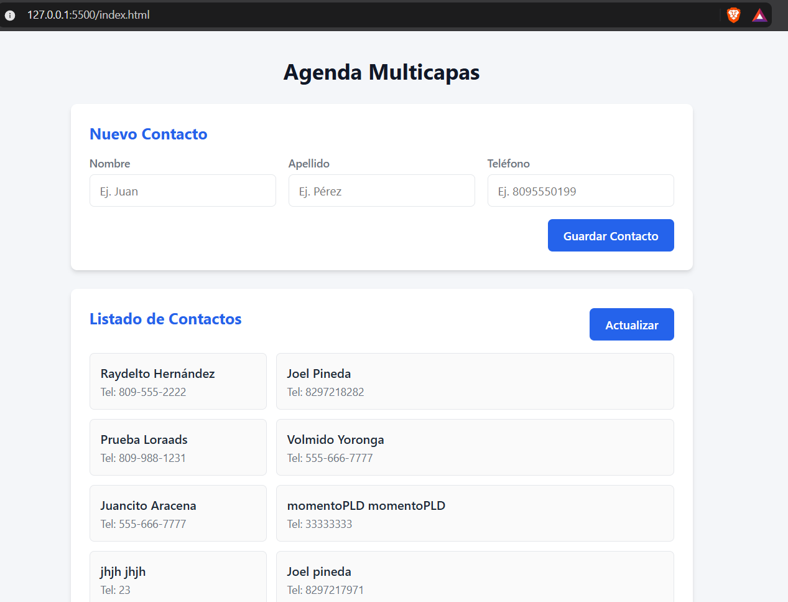

# Agenda Multicapas

Agenda de contactos en React (Vite). Hecha por: Edwin Rondon (2024-1870)



## Componentes

- `App` — componente padre; mantiene el estado de contactos y carga/guarda vía API
- `AddContact` — formulario para agregar contactos
- `ContactList` — listado de contactos

## Desarrollo

```bash
npm install
npm run dev
```

API: `http://www.raydelto.org/agenda.php`
